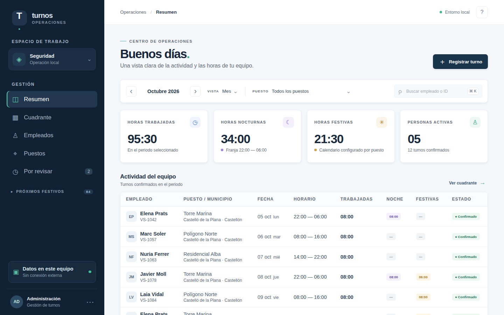
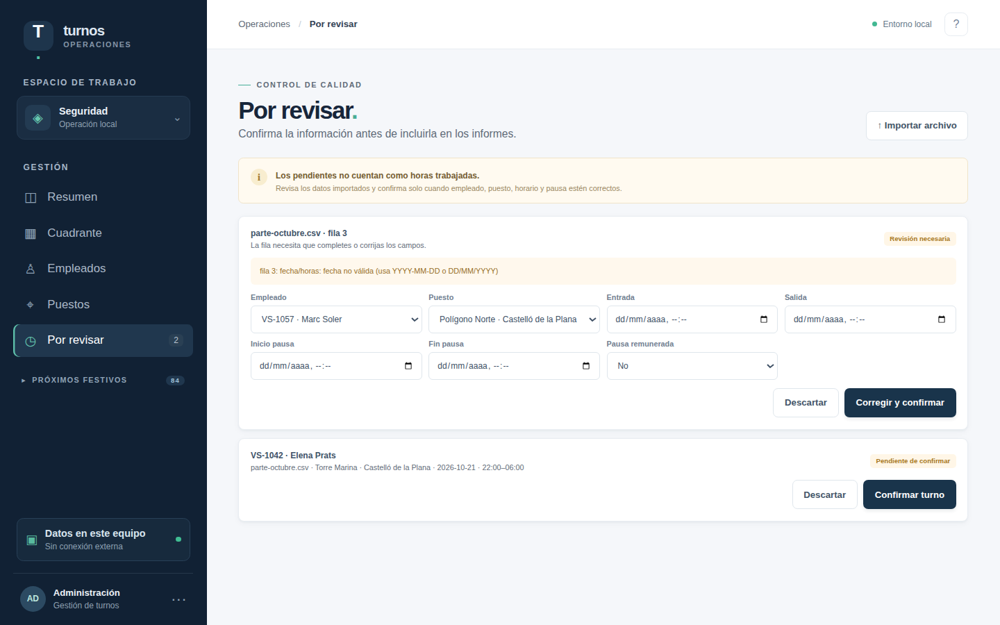
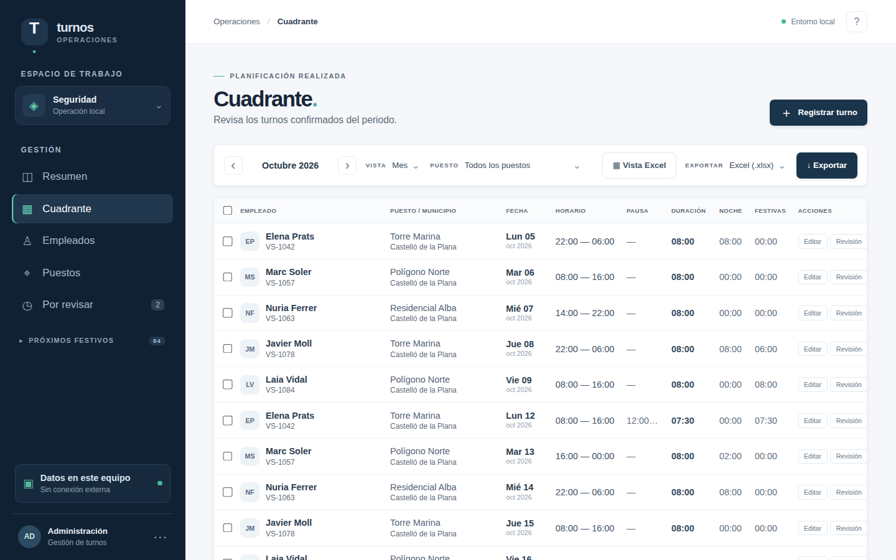
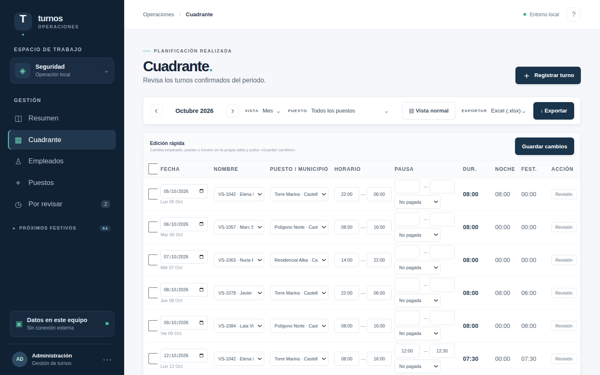
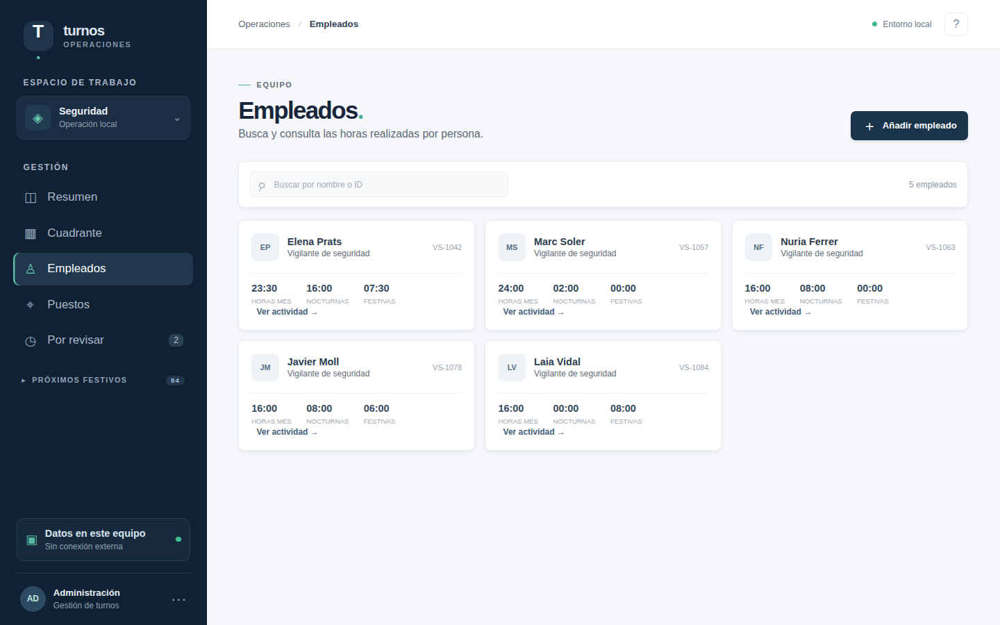
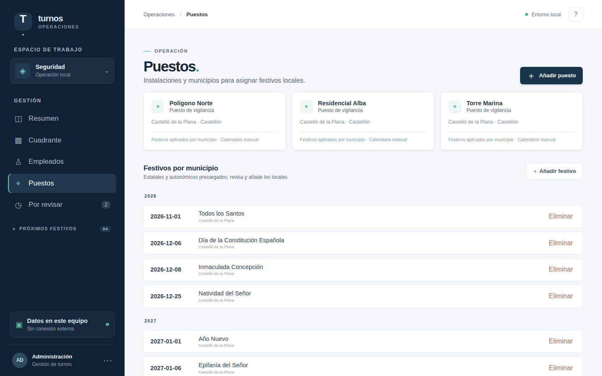

<div align="center">


# MVSCS Private Dashboard

### Panel local de cuadrantes y horas · **MED Vigilantes Castellón**

**Registra turnos, importa cuadrantes y calcula horas nocturnas y festivas sin enviar nada fuera de tu equipo.**

[Inicio rápido](#-inicio-rápido) · [Modo de uso](#-modo-de-uso) · [Importación](#-importación) · [Festivos](#-festivos-oficiales) · [Estructura](#-estructura-del-proyecto)

</div>

---

## ¿Qué es?

Una aplicación **100 % local** (FastAPI + SQLite + HTML/CSS/JS) para equipos de seguridad privada. Todo ocurre en tu ordenador: no hay cuentas, ni nube, ni telemetría. La base se guarda en `data/quadrants.sqlite3`.

- Panel mensual y anual con horas trabajadas, **nocturnas** y **festivas** en `HH:MM`.
- Empleados y **puestos** con municipio y provincia.
- Registro manual de turnos (varios al día, cruce de medianoche, pausas remuneradas/no remuneradas).
- **Importación** de CSV, Excel (`.xlsx`/`.xlsm`) y PDF digital, o de un **resumen mensual**.
- Bandeja de **revisión** y **unificación de duplicados**.
- **Vista Excel** editable en línea y **exportación XLSX/CSV** del periodo, con fechas comentadas (`Lun 19 oct`).
- **Festivos oficiales** estatales, autonómicos y locales de Castelló generados por reglas hasta cinco años vista; los descartes son duraderos.
- **Revisión** de turnos pendientes, filas dudosas y **resúmenes mensuales** (sin convertirlos en turnos).
- Interfaz responsive servida por la propia app, sin datos de ejemplo: la base arranca limpia.

## Inicio rápido

### 1. Descargar

```bash
git clone https://github.com/yosoyignicion/MVSCS.git
cd MVSCS
```

O descarga el ZIP desde <https://github.com/yosoyignicion/MVSCS> → **Code ▸ Download ZIP** y descomprímelo.

### 2. Requisitos

Solo necesitas **Python 3.10 o superior**. El iniciador instala el resto la primera vez.

### 3. Abrir la app (iniciador con logotipo)

| Sistema | Cómo |
|---|---|
| **Windows** | Doble clic en `launcher\launch.bat` |
| **macOS** | Doble clic en `launcher/launch.command` |
| **Linux** | `python3 launcher/launch.py` — o crea un acceso directo en el menú con `bash launcher/install_desktop.sh` |
| **Cualquiera** | `python launcher/launch.py` |

Se abre una **ventana con el logo** que arranca el servidor y te lleva al navegador en `http://127.0.0.1:8000/`. Al pulsar **Cerrar** se detiene todo. Si el puerto 8000 está ocupado, el iniciador usa el siguiente libre.

> ¿Prefieres hacerlo a mano? `pip install -r requirements.txt` y luego `uvicorn main:app --host 127.0.0.1 --port 8000`.

## Modo de uso

### Resumen del panel

Al abrir verás el panel con los totales del periodo, la actividad y la zona de importación.



### 1. Importación (automática, con revisión)

Arrastra un archivo a la zona **Importar cuadrante** (o usa *Seleccionar archivo*). La app:

1. Lee el archivo y detecta el formato (CSV, Excel o PDF) **validando la firma real**, no solo la extensión.
2. **Auto-crea** el empleado (por ID) y el puesto (por nombre + municipio) que falten.
3. Deja los turnos válidos **pendientes de confirmar** y las filas dudosas en **Por revisar**.
4. Guarda los **resúmenes mensuales** aparte (no suman a las métricas de turnos).

Formatos admitidos: CSV (`, ; tab |`, UTF-8/Windows-1252/Latin-1) y Excel (se elige la hoja y la fila de encabezados aunque haya títulos), ambos con detección de cabeceras; PDF digital con tabla. Se combinan las hojas/tablas válidas y el límite es de 5000 filas. Ver detalles en [`docs/importacion.md`](docs/importacion.md).

### 2. Revisión manual

En **Por revisar** corriges lo dudoso (empleado, puesto, horario, pausa) y confirmas. Los **resúmenes mensuales** con errores tienen su propio editor (empleado, mes y horas) y nunca se convierten en turnos. Nada entra en los informes hasta confirmarlo.



Si el mismo **nombre** aparece con **IDs distintos**, la app lo detecta y lo muestra en **Posibles duplicados** para que un humano decida **unificar**.

### 3. Modificación y consulta

El **Cuadrante** muestra los turnos confirmados; puedes editar un turno, **exportar el periodo a Excel o CSV** o cambiar a **Vista Excel** para edición rápida en una tabla compacta. Las fechas se muestran comentadas con el día de la semana y el número del día (`Dom 18 oct`), y la vista Excel sigue el orden habitual de trabajo (fecha, nombre, puesto/municipio, horario, pausa, duración, noches y festivas). Desde la misma tabla puedes seleccionar turnos (uno o varios) y **enviarlos a revisión**: dejan de sumar en los totales hasta que los confirmes de nuevo.



Vista Excel para edición rápida, con la fecha comentada y las columnas habituales de trabajo:



### 4. Empleados y puestos



### 5. Puestos y festivos

Cada puesto tiene municipio y provincia. Los festivos se aplican **por municipio del puesto**: los nacionales y autonómicos se replican a todos los municipios con puestos y los locales de Castelló se calculan por reglas. Si descartas un festivo, no reaparece al reiniciar.



## Importación

Encabezados preferidos (admiten alias en español e inglés):

```csv
id,puesto,municipio,provincia,fecha,entrada,salida,pausa inicio,pausa fin,pausa remunerada
VS-1042,Edificio principal,València,Valencia,2026-04-10,22:00,06:00,01:00,01:30,no
```

- La fecha es el día de **entrada**; una salida anterior se interpreta como el día siguiente. Si la salida trae fecha completa, se respeta y se rechazan turnos de más de 24 h.
- Se aceptan CSV con `,`, `;`, tabulador o `|`; UTF-8, Windows-1252 o Latin-1; y fechas `YYYY-MM-DD`, `YYYYMMDD`, `DD/MM/YYYY` o serial de Excel. En Excel se detectan la hoja y la fila de encabezados aunque haya títulos delante; en PDF se combinan las tablas válidas.
- Con pausa, `pausa remunerada` debe ser explícita (`sí`/`no`).
- **Resumen mensual** (formato alternativo): `id;nombre;mes;horas totales` — p. ej. `SEG-001;Álvaro Castro;2026-07;200`. Se guarda aparte y se corrige desde **Por revisar**.

**Exportación**: el selector `Exportar` ofrece Excel (`.xlsx`) y CSV. El Excel es el formato recomendado: reproduce la vista de trabajo habitual (fecha comentada con día de la semana, nombre, puesto/municipio, horario, pausa, duración, noches y festivas) y puede volver a importarse. Ambos formatos respetan el periodo y el puesto seleccionados.

## Festivos oficiales

La app **genera por reglas** los festivos **estatales, autonómicos y locales de Castelló de la Plana** desde 2025 y hasta cinco años vista, sin conexión: nacionales y autonómicos se replican a todos los municipios con puestos; los locales de Castelló se calculan con Magdalena = lunes de la tercera semana de Cuaresma y San Pedro = 29 de junio (trasladado al lunes si cae en domingo).

En **Puestos ▸ Festivos por municipio** se muestran los festivos **desde hoy en adelante**, agrupados por año. La barra lateral incluye un bloque plegable con los **próximos cuatro**, cerrado por defecto para no restar espacio. Los locales de otros municipios se añaden o revisan a mano.

Fuentes oficiales si necesitas verificarlos:

- **Estatales**: [BOE](https://www.boe.es) — calendario laboral anual (Resolución de la Dirección General de Trabajo).
- **Autonómicos (Comunitat Valenciana)**: [DOGV / Generalitat Valenciana](https://dogv.gva.es) — resolución de fiestas laborales del Consell.
- **Locales de Castelló de la Plana**: [Ajuntament de Castelló](https://www.castello.es) y el *Boletín Oficial de la Provincia de Castellón* (BOP).

La app no descarga de Internet en tiempo de ejecución; la generación es offline e idempotente. Los años calculados son una **previsión revisable** y no certifican que el calendario laboral publicado esté completo: confirma las fechas con el BOE, DOGV y el BOP antes de usarlas para nómina.

## Uso responsable

Esto es una herramienta de **registro y cálculo**, no un sistema de nómina ni una interpretación de convenio. Verifica festivos, pausas y municipios. Los informes solo suman turnos **confirmados**.

## Estructura del proyecto

```text
main.py                 Backend completo (FastAPI + SQLite + reglas + importadores)
static/                 Interfaz (HTML/CSS/JS sin framework)
assets/                 Logotipo e iconos (SVG/PNG/ICO)
launcher/               Iniciador multiplataforma (ventana con logo)
tests/test_app.py       Pruebas de API y reglas de cálculo
docs/                   Documentación y capturas de ejemplo
data/                   Base local y registro (no se versiona)
requirements.txt        Dependencias
```

## Desarrollo y pruebas

```bash
python3 -m venv .venv && source .venv/bin/activate
pip install -r requirements.txt

python3 -m pytest -q            # pruebas
python3 -m py_compile main.py   # compila el backend
node --check static/app.js      # revisa el JS
```

## Licencia

MIT — consulta [`LICENSE`](LICENSE).
